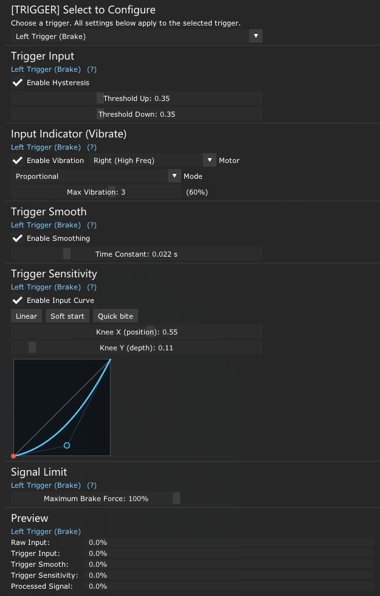

# Gamepad Tweaks untuk Assetto Corsa

**GamepadTweaks** adalah script Gamepad FX dan aplikasi UI in-game untuk Custom Shaders Patch (CSP) yang digunakan untuk kalibrasi dan menyesuaikan trigger gamepad dan mengatur getaran controller.

## Fitur

### Trigger Signal

- **Trigger Input:** Mengurangi noise di sekitar posisi awal trigger.
- **Input Indicator (Vibrate):** Memberitahu apakah sinyal input sdh masuk atau belum dengan getaran. Terdapat pilihan jenis getaran, pilihan motor, dan level getaran 0–5 (`0–100%`).
- **Trigger Smooth:** Memperhalus sinyal input dengan pengaturan time constant.
- **Trigger Sensitivity:** Sensitivitas sinyal terhadap input user dengan kurva input. Berguna untuk trail braking (memperhalus pelepasan rem) atau throttle control (memperhalus throttle maksimal).
- **Signal Limit (Tersedia di LT (Brake)):** Membatasi output maksimum dari `0–100%` setelah Trigger Sensitivity. Berguna untuk mobil yang tidak menyediakan braking force dari setup bawaan.
- **Preview:** menampilkan Raw Input, Trigger Input, Trigger Smooth, Trigger Sensitivity, dan Processed Signal akhir.

### Vibration

**Vibration Manager** mengatur efek getaran game seperti tire slip, kerb, ABS, collision, G-force, off-road, engine RPM, dan gearshift. Setiap efek dapat diatur dari level `0` sampai `5` (`0%`, `20%`, `40%`, `60%`, `80%`, atau `100%`) serta diarahkan ke motor kiri, motor kanan, atau keduanya.

### More

- **My Configuration:** export atau import `gamepad_tweaks_export.ini`.
- **About GamepadTweaks:** informasi versi dan author.

🔗 **[Download & Setup Guide on Overtake.gg](https://www.overtake.gg/downloads/gamepad-tweaks-hall-trigger-deadzone-fix-haptic-feedback.86222/)**