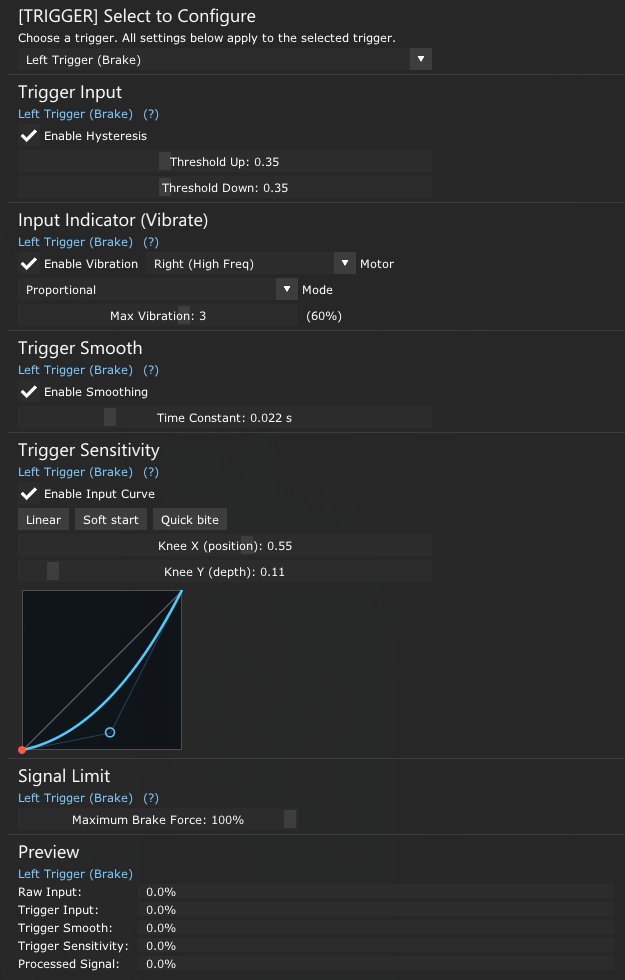
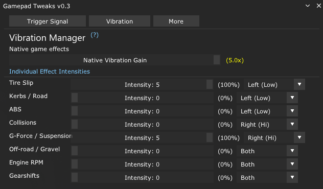

# Gamepad Tweaks for Assetto Corsa

**GamepadTweaks** is a Custom Shaders Patch (CSP) Gamepad FX script and in-game UI app for calibrating and adjusting gamepad triggers and configuring controller vibration.

## Features

### Trigger Signal

- **Trigger Input:** reduces noise around the trigger's resting position.
- **Input Indicator (Vibrate):** indicates whether the input signal has been received through vibration. Includes vibration mode, motor selection, and vibration level 0–5 (`0–100%`).
- **Trigger Smooth:** smooths the input signal with an adjustable time constant.
- **Trigger Sensitivity:** adjusts how sensitive the signal is to user input through an input curve. Useful for trail braking (smoother brake release) or throttle control (smoother maximum throttle response).
- **Signal Limit (available for LT/Brake):** limits the maximum output from `0–100%` after Trigger Sensitivity. Useful for cars that do not provide a braking force setting in their built-in setup.
- **Preview:** displays Raw Input, Trigger Input, Trigger Smooth, Trigger Sensitivity, and the final Processed Signal.

### Vibration

**Vibration Manager** controls game vibration effects such as tire slip, kerbs, ABS, collisions, G-force, off-road surfaces, engine RPM, and gearshifts. Each effect can be adjusted from level `0` to `5` (`0%`, `20%`, `40%`, `60%`, `80%`, or `100%`) and routed to the left motor, right motor, or both.

### More

- **My Configuration:** export or import `gamepad_tweaks_export.ini`.
- **About GamepadTweaks:** version and author information.

## Screenshoot

**Trigger Signal**

**Vibration**

🔗👉 **[Download & Setup Guide on Overtake.gg](https://www.overtake.gg/downloads/gamepad-tweaks-hall-trigger-deadzone-fix-haptic-feedback.86222/)**
